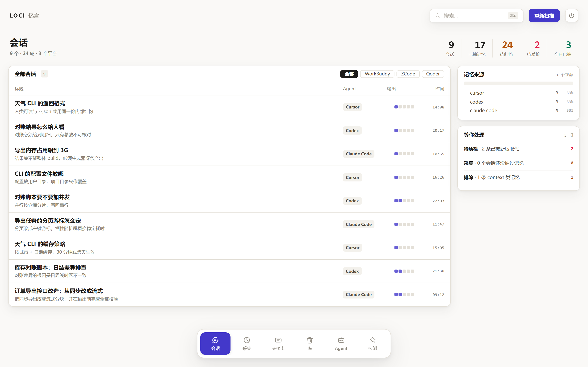

<p align="center"></p>

<p align="center"><b>a memory palace your agents share.</b><br>One local memory, shared by every AI agent you use.</p>

# Loci

[](LICENSE)
[](pyproject.toml)
[](pyproject.toml)
[](loci.py)

[简体中文](README.md) ｜ English

Zero dependencies · Chinese-aware search · standard MCP · one-file web panel · data stays on your disk

## Why this project

In the morning you explained the project background, the tech choices, the pitfalls you already hit. At noon you try the new model from vendor B — **it knows none of it**, so you explain again. In the evening you switch back to C to save quota, and explain again.

| Who you are | Where it breaks |
|---|---|
| **Multi-agent / multi-harness user** | Decisions, implicit conventions and pitfalls all live in the previous product. Switch, and you lose them |
| **Model comparison tester** | You want the same task run under different harnesses / models, but context can't move — so you keep pasting the same background |
| **Free-tier hopper** (living off trial credits) | Whichever vendor has quota today wins; you switch three or four times a day and rebuild context every time |

Loci takes memory out of the harness: one local SQLite file, exposed over standard MCP to every agent.

- **Swap the agent, keep the memory** — one `memory_context` call at the start and the new session already knows your decisions, pitfalls and preferences. 15 products can be wired up in one click
- **Conclusions, not chat logs** — transcripts go to the session store for your own review; decisions / pitfalls / preferences go to the memory store
- **No money, no network** — search is local bigram + TF-IDF: no model calls, no tokens, no requests
- **Chinese actually works** — Chinese in, Chinese out, matched by local tokenization rather than guessed by a model
- **Zero dependencies, small enough to read** — one-file Python + one SQLite file, no third-party packages to be poisoned or silently upgraded; ~4000 lines
- **Nothing enters memory quietly** — every write returns a **receipt** (what was written / where it belongs / which session it came from / how to undo it); on a duplicate it **says so** instead of pretending it wrote

<p align="center"></p>

## Six pages

### Sessions — what each agent said to you

Every conversation, grouped by agent (title, summary, source, time). Click through to a detail page: turn-by-turn transcript plus the memories extracted from that conversation.
Right column: memory sources, and what's waiting on you (needs review / not yet collected / excluded). Existing local conversations can be pulled in with one scan.

### Collect — pull the scattered history in

Scans each agent's local logs and skills directories, lists candidates, imports the ones you tick.
Deduplicated (including "the same daily log growing longer each day") and path-allowlisted. Scan roots are editable.

### Handoff — hand a project to the next agent

Pick a project, get a markdown handoff card: confirmed decisions, conventions, pitfalls, facts — each tagged with its Git branch.
Copy it, paste it into any agent.

### Library — the memories, and their upkeep

Search and browse everything; a seven-check review (duplicates / near-synonyms / possible contradictions / stale / too short / too coarse / missing metadata) with a 0–100 health score;
backup, export, restore, destroy (confirmed first; only the database is touched, never your source files).

### Agents — who's installed, who's connected

Lists which agents exist on this machine, which are already wired to Loci, and whether each data directory is readable.
"Connect" writes the MCP config for you (backs up first, merges rather than overwrites), and can be removed or handshake-verified.

### Skills · MCP — reuse across agents

The local skill inventory and its distribution (how many agents carry a given skill), with cross-agent copy;
view and copy MCP configs so you don't retype them per product.

## Quick start

Requires Python 3.9+. No third-party dependencies.

```bash
git clone https://github.com/kennytoliver/loci-local.git
cd loci-local
python panel.py --open
```

Want a double-click launcher? Make a shortcut to `python panel.py --open`.

Then go to the **Agents** page and hit "Connect" for whatever you have installed.

Without the panel:

```bash
python install_agents.py --list     # what's installed here
python install_agents.py --all      # connect everything (backs up first)
python install_agents.py --verify   # real MCP handshake
```

Manual wiring for any MCP client:

```json
{"command": "python", "args": ["-X", "utf8", "/path/to/loci.py"]}
```

> Windows first. It runs on macOS / Linux, with a few features degraded (e.g. trash-based delete).

How to use the pages, and what to do when something looks wrong — see **[USAGE.md](USAGE.md)**.

## Your data stays yours

One SQLite file. No account, no API key, no telemetry, no cloud copy. The panel only listens on `127.0.0.1`; agents talk over stdio and never touch a port.

```bash
grep -nE "^\s*(import|from) " loci.py            # stdlib only
grep -nE "urlopen|requests\.|socket\." loci.py   # the engine makes no network calls
wc -l loci.py                                     # ~4000 lines
```

Any process on this machine that can read the file can read every memory — protect it with file permissions.
The four rounds of external review are in [AUDIT-LOG.md](AUDIT-LOG.md).

## Files

| | |
|---|---|
| `loci.py` | engine + MCP server + CLI |
| `panel.py` | one-file web panel |
| `install_agents.py` | command-line installer |
| `loci.db` | the database (created on first run, gitignored) |

## Contributing

Issues and PRs welcome. One hard rule: **no third-party dependencies** — zero dependencies is the whole point. See [CONTRIBUTING.md](CONTRIBUTING.md).

## Acknowledgements

Thanks to [MemForge](https://github.com/gitstq/MemForge) (MIT) for proving the local-first, single-file memory store was a viable path.

## License

MIT © Loci contributors.
